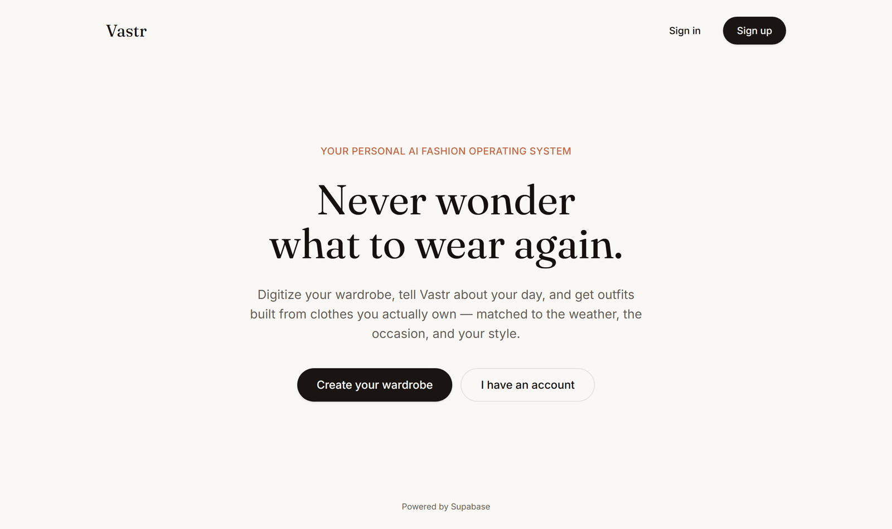
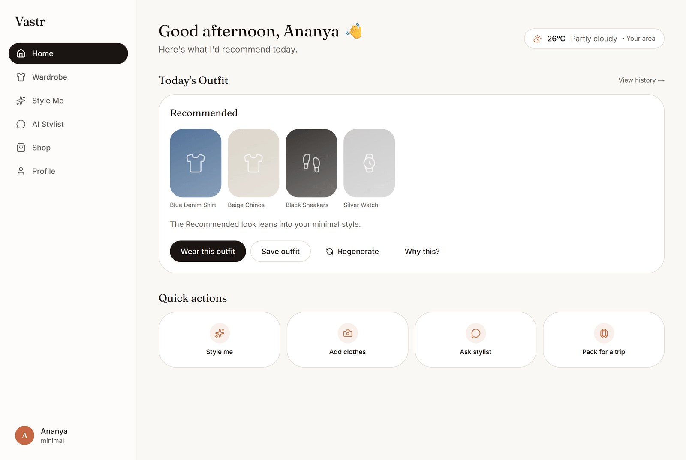
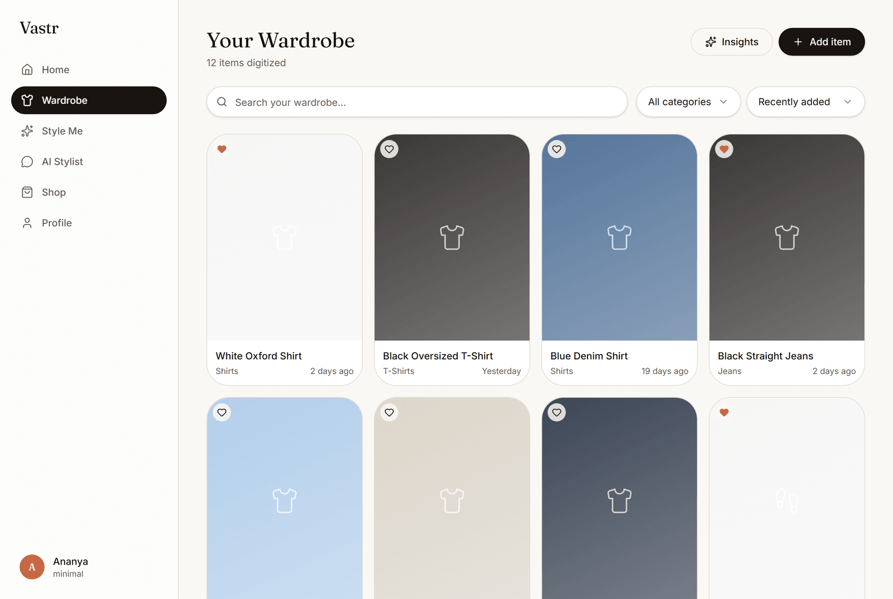
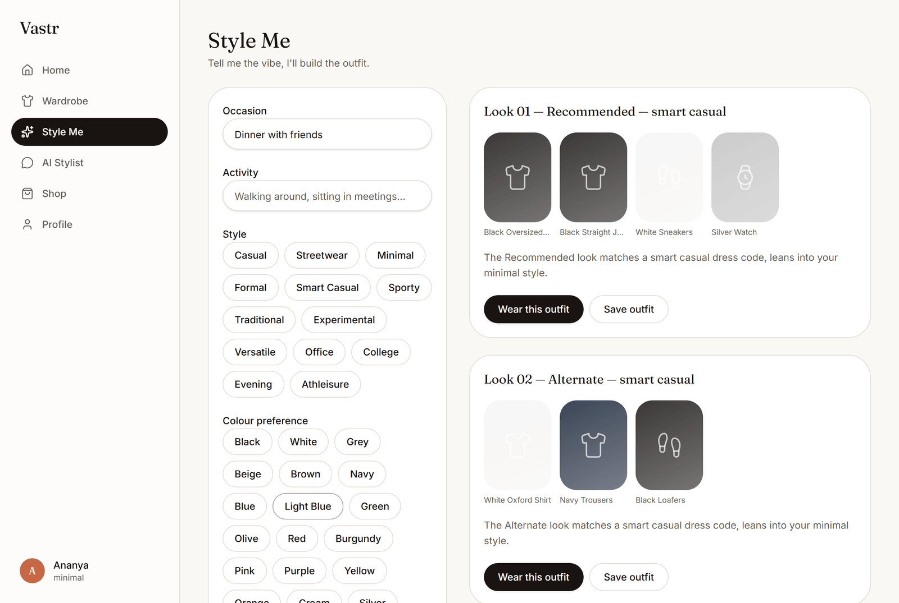
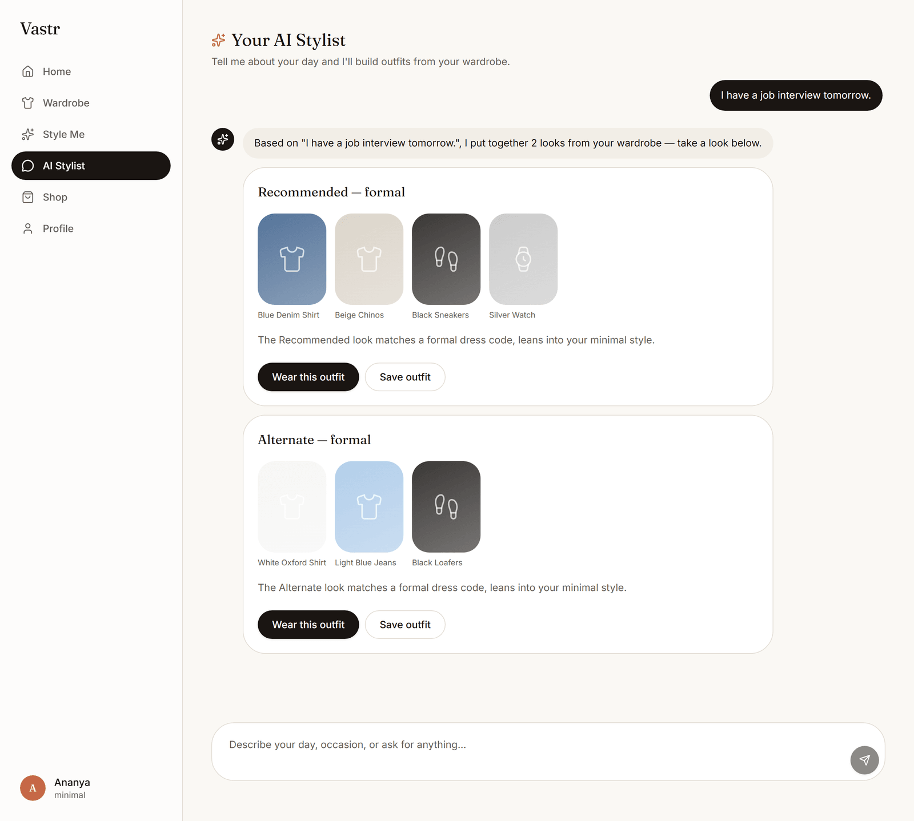
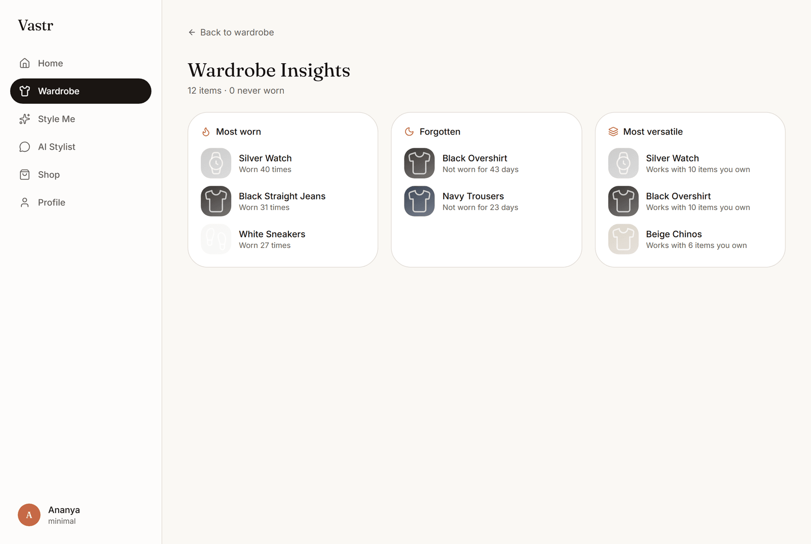
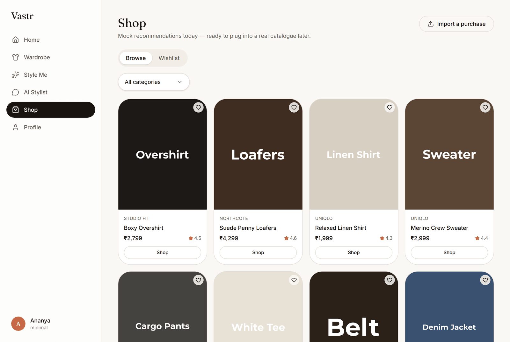
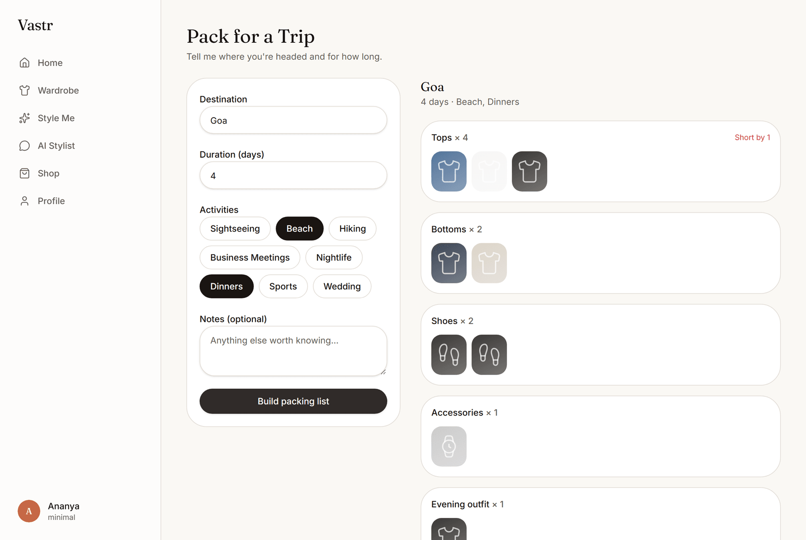
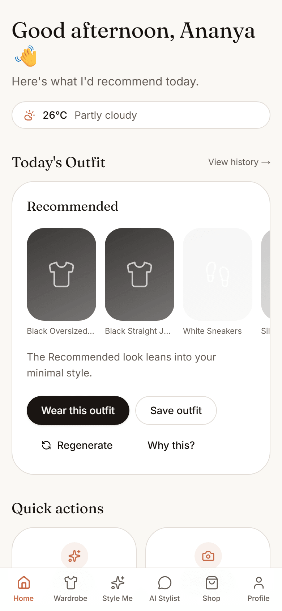
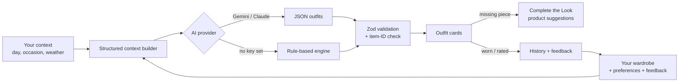

<div align="center">

# Vastr

### Your personal AI fashion operating system

Digitize your wardrobe, tell Vastr about your day, and get outfits built from the clothes you actually own, matched to the weather, the occasion, and your style.

[**Live demo**](https://vastr-silk.vercel.app) &nbsp;·&nbsp; [Features](#features) &nbsp;·&nbsp; [Quick start](#quick-start) &nbsp;·&nbsp; [Deploy](#deploying-to-vercel) &nbsp;·&nbsp; [Architecture](#architecture)




</div>

---

## Table of contents

- [What is Vastr?](#what-is-vastr)
- [Features](#features)
- [How it works](#how-it-works)
- [Quick start](#quick-start)
- [Configuration](#configuration)
- [Setting up Supabase](#setting-up-supabase)
- [Setting up AI](#setting-up-ai)
- [Deploying to Vercel](#deploying-to-vercel)
- [Installing on your phone (PWA)](#installing-on-your-phone-pwa)
- [Architecture](#architecture)
- [Project structure](#project-structure)
- [Database](#database)
- [Scripts](#scripts)
- [Troubleshooting](#troubleshooting)
- [Known limitations](#known-limitations)
- [Roadmap](#roadmap)

---

## What is Vastr?

Most people own plenty of clothes and still stand in front of the closet thinking *"I have nothing to wear."* Vastr fixes that by turning your closet into data and putting an AI stylist on top of it.

You build a digital version of your wardrobe (snap a photo and let AI fill in the details, or add items by hand). From then on Vastr can:

- Recommend **today's outfit** using your real clothes plus the current weather.
- Build **three looks on demand** for any occasion, mood, or colour palette.
- **Chat** about your day ("college presentation in the morning, dinner at night") and answer with outfits made from what you own.
- Show **which pieces you over-wear, forget, or could pair more**, and where your wardrobe has gaps.
- Suggest **what to buy next**, only when something is genuinely missing.
- Build a **packing list** from your closet for any trip.

> The stylist never invents clothes you don't own. Every item an AI response references is checked against your real wardrobe before it is shown.

---

## Features

### Home: "What should I wear today?"

A greeting, live weather, and a ready-made outfit for today. Wear it, save it, regenerate it, or ask why it was picked.

<p align="center"></p>

### Digital wardrobe

Every piece is a card with category, colour, formality, season, fit, brand, size, style tags, wear count, and last-worn date. Add, edit, delete, favourite, search, filter and sort (most worn, least worn, never worn, recently added).

Uploading a photo runs AI vision analysis, which pre-fills every field. You always get an editable review step before anything is saved.

<p align="center"></p>

### Bulk photo upload (Google Drive style)

Pick or drag in dozens of photos at once (or use **Add → Take a photo** on a phone). Vastr shrinks each photo on your device, analyzes them in the background, and shows a progress tray that stays on screen while you keep browsing:

> **Analyzing 6 of 15** · about 40 sec left

When it's done, one review screen lists every detected piece (name, category, colour) for quick fixes, and a single tap adds them all.

Free AI tiers are strict about request limits, so users should never see "rate limited, try again". Instead the queue:
- holds photos locally and sends only a few requests per minute, **packing several photos into each request** (15 photos need just 4 requests);
- pauses and resumes by itself, for exactly as long as the provider asks, if a limit is hit anyway;
- falls back through a chain of models (limits are per model) and, as a last resort, fills in a rough estimate flagged "please check" rather than failing;
- shows a time estimate based on the real pacing, not a guess.

### Style Me

Pick an occasion, activity, style, and colours (or hit **Surprise me**) and get three distinct looks, each with an explanation and **Wear this** / **Save outfit** actions.

<p align="center"></p>

### AI Stylist chat

Describe your day in plain language and get a conversational reply with outfit cards inline. Conversations are saved, so you can come back to them.

<p align="center"></p>

### Wardrobe insights

Most worn, forgotten pieces, most versatile items, and detected wardrobe gaps, with product suggestions for whatever is missing.

<p align="center"></p>

### Shop and "Complete the Look"

A product catalogue with wishlist. When an outfit is missing a piece, **Complete the look** shows matching products. The catalogue is seeded mock data today and sits behind a single service, so a real affiliate API can replace it later without touching the UI. **Import a purchase** lets you add a bought item to your wardrobe from a photo.

<p align="center"></p>

### Pack for a Trip

Enter a destination, number of days, and activities. Vastr builds a packing list from clothes you own and flags what you are short on.

<p align="center"></p>

### Also included

- **Onboarding wizard**: name, styling category, preferred styles, colours loved and avoided, typical occasions, and budget, ending with "scan my clothes" or "add manually" (never forced).
- **Outfit history** with 👍 / 🙂 / 👎 feedback and reason chips ("too formal", "uncomfortable", and so on), stored for future recommendations.
- **Profile** where you can edit your style preferences at any time.
- **Mobile-first layout**: sidebar on desktop, bottom navigation on phones.
- **Installable PWA** with its own icon and standalone mode.

### Built for mobile

<p align="center"></p>

> The screenshots above use the built-in demo wardrobe, which has no photos, so items show as colour tiles. Items you upload show your own photos.

---

## How it works



1. The app builds a **compact, structured context**: your preferences, weather, request, constraints, a trimmed view of your wardrobe, and recent outfit feedback. It never sends the whole database.
2. The AI returns **structured JSON**, validated with Zod.
3. Every item ID in the response is **cross-checked against your real wardrobe**. Unknown IDs are dropped.
4. If the AI call fails or returns something invalid, the app **falls back to a built-in rule-based engine** so the product keeps working.

---

## Quick start

**Requirements:** Node.js 20+ and npm.

```bash
git clone https://github.com/VismayVChandra/vastr.git
cd vastr
npm install
npm run dev
```

Open [http://localhost:3000](http://localhost:3000).

### Two ways to run it

| | **Demo mode** (zero config) | **Full mode** |
|---|---|---|
| Setup | None. Don't create `.env.local`. | Add Supabase and AI keys. |
| Accounts | A browser-local profile, no sign-up | Real email/password accounts |
| Data | Stored in the browser (`localStorage`), seeded with a 12-item starter wardrobe | Stored in your Supabase Postgres, starts empty per user |
| Photos | Kept inline in the browser | Uploaded to Supabase Storage |
| AI | Offline estimator and rule-based stylist | Real Gemini or Claude vision and outfit reasoning |

Demo mode is the fastest way to explore the whole product. Full mode is what the live site runs.

---

## Configuration

Copy the template and fill in what you need:

```bash
cp .env.example .env.local
```

| Variable | Required | Purpose |
|---|---|---|
| `NEXT_PUBLIC_SUPABASE_URL` | For full mode | Your Supabase project URL |
| `NEXT_PUBLIC_SUPABASE_ANON_KEY` | For full mode | Supabase anon (public) key |
| `GEMINI_API_KEY` | Optional | Enables real AI via Google Gemini (checked first) |
| `GEMINI_MODEL` | Optional | Override the Gemini model (default `gemini-3.6-flash`) |
| `ANTHROPIC_API_KEY` | Optional | Enables real AI via Claude, used only if no Gemini key is set |
| `ANTHROPIC_VISION_MODEL` / `ANTHROPIC_TEXT_MODEL` | Optional | Override the Claude models |
| `GEMINI_MODELS` | Optional | Comma-separated fallback chain of Gemini models (quotas are per model). Default: `gemini-3.6-flash,gemini-3.5-flash-lite,gemini-3.1-flash-lite` |
| `NEXT_PUBLIC_AI_REQUESTS_PER_MINUTE` / `NEXT_PUBLIC_AI_IMAGES_PER_REQUEST` | Optional | Bulk-upload pacing (defaults: 4 requests/min, 4 photos per request) |

- Weather uses [Open-Meteo](https://open-meteo.com) and needs **no key**.
- `.env.local` is git-ignored. **Never commit real keys.**
- Next.js reads env files at startup, so **restart the dev server after editing `.env.local`**.

---

## Setting up Supabase

1. Create a free project at [supabase.com](https://supabase.com).
2. Open **SQL Editor** and run the contents of [`supabase/schema.sql`](supabase/schema.sql). It creates all tables, row-level security policies, a public `wardrobe` storage bucket, and a trigger that creates a profile row on sign-up.
3. Copy **Project URL** and **anon key** from *Project Settings → API* into `.env.local`.
4. In *Authentication → URL Configuration*, add your site URL(s) (for example `http://localhost:3000` and your production URL) so sign-up and login redirects work.
5. Restart the dev server. `/signup` and `/login` now create real accounts.

Row-level security is enabled on every table, so a user can only ever read or write their own data.

---

## Setting up AI

Vastr works without any AI key, but real vision and outfit reasoning is much sharper.

**Gemini (recommended, free tier)**

1. Create a key at [aistudio.google.com/apikey](https://aistudio.google.com/apikey). No billing is required.
2. Add `GEMINI_API_KEY=...` to `.env.local` and restart.

**Claude (alternative)**

Set `ANTHROPIC_API_KEY=...` instead. If both keys are set, Gemini wins.

**Free-tier limits (measured)**

On the Gemini free tier each model allows about **5 requests per minute and 20 requests per day**. The limits are per model and shared by everyone using your key (photo analysis and outfit generation both count). Vastr paces its requests and falls back across models, but a free key still caps out at roughly 60 requests a day across the default chain. For real users, enable billing on the Google project: image analysis costs a fraction of a cent per photo and the limits become far higher. Model names also change as Google retires them, so set `GEMINI_MODELS` to ones your key can use.

When a real key is active, uploading a clothing photo shows *"AI filled these in from your photo"*. If a provider call fails, the note instead says the call failed and the result is an offline estimate (check the server logs for the reason).

---

## Deploying to Vercel

1. Push the repository to GitHub.
2. Go to [vercel.com/new](https://vercel.com/new) and import the repo. Vercel detects Next.js automatically.
3. Under **Environment Variables**, add `NEXT_PUBLIC_SUPABASE_URL`, `NEXT_PUBLIC_SUPABASE_ANON_KEY`, and `GEMINI_API_KEY`.
4. Deploy. Every later push to `main` redeploys automatically.
5. Add your Vercel URL to Supabase *Authentication → URL Configuration*, otherwise sign-up and login won't work on the deployed site.

---

## Installing on your phone (PWA)

Vastr ships a web app manifest, an icon set, and a small service worker, so it can be installed like an app.

- **Android (Chrome):** menu → **Install app** / **Add to Home screen**.
- **iPhone (Safari):** Share → **Add to Home Screen**.

It then opens full-screen with the Vastr icon and no browser address bar. The service worker is only registered in production builds.

---

## Architecture

- **Next.js 16 (App Router) + React 19 + TypeScript + Tailwind CSS v4.** UI primitives in `src/components/ui` are hand-built on Radix and class-variance-authority, with no heavy component library.
- **Dual persistence.** Every function in `src/services/*` checks whether Supabase is configured and transparently uses either Supabase or a `localStorage`-backed store. Components never know which backend is active.
- **Swappable AI providers** (`src/lib/ai/*`). Vision analysis and outfit generation each have a Gemini implementation, a Claude implementation, and a mock. `config.ts` picks whichever provider has a key. The model response is Zod-validated and item IDs are verified against the real wardrobe.
- **Weather** (`src/lib/weather/*`). Open-Meteo plus reverse geocoding, both keyless, with a mock fallback when location is denied.
- **Client state** with Zustand stores for wardrobe, outfits, and wishlist; a small pub-sub hook for auth and profile.
- **Server-only secrets.** AI keys are read only in API routes (`src/app/api/*`) and never reach the browser.
- **Next.js 16 conventions.** Request interception lives in `src/proxy.ts` (the successor to `middleware.ts`).

---

## Project structure

```
vastr/
├── src/
│   ├── app/
│   │   ├── (app)/              # Authenticated pages: home, wardrobe, style-me,
│   │   │                       #   stylist, shop, trips, history, profile
│   │   ├── api/                # analyze-image, outfits/generate, trips/pack, weather
│   │   ├── login/  signup/  onboarding/
│   │   ├── manifest.ts         # PWA manifest
│   │   └── page.tsx            # Landing page
│   ├── components/             # ui/, nav/, wardrobe/, outfit/, stylist/, shop/, shared/
│   ├── hooks/                  # use-auth, use-weather, use-outfit-generator
│   ├── lib/
│   │   ├── ai/                 # providers, prompts, Zod schemas, mock engines
│   │   ├── supabase/           # browser/server clients and config
│   │   ├── store/              # local-db, seed wardrobe, mock product catalogue
│   │   └── weather/
│   ├── services/               # Persistence layer (Supabase or local)
│   ├── store/                  # Zustand stores
│   ├── types/
│   └── proxy.ts
├── supabase/schema.sql         # Tables, RLS, storage bucket, signup trigger
├── public/
│   ├── icons/                  # PWA icons
│   ├── screenshots/            # Images used in this README
│   └── sw.js                   # Service worker
└── .env.example
```

---

## Database

Created by [`supabase/schema.sql`](supabase/schema.sql), all with UUID keys, `created_at` / `updated_at`, and owner-only RLS:

| Table | Holds |
|---|---|
| `profiles` | Name, style preferences, colours, occasions, budget (auto-created on sign-up) |
| `wardrobe_items` | Every clothing item and its attributes, wear count, last worn |
| `outfits` | Saved and generated outfits, wear dates, rating, feedback reasons |
| `wishlist` | Saved shop products |
| `trips` | Trip details, packing list, missing items |
| `chat_sessions` / `chat_messages` | AI stylist conversations |

Photos are stored in a public `wardrobe` storage bucket, in a per-user folder that only the owner can write to.

---

## Scripts

| Command | What it does |
|---|---|
| `npm run dev` | Start the dev server |
| `npm run build` | Production build (also type-checks) |
| `npm run start` | Serve the production build |
| `npm run lint` | Run ESLint |

---

## Troubleshooting

**AI results look random or say "no AI key configured".** The server only reads `.env.local` at startup. Restart `npm run dev` after adding a key.

**"The AI provider call failed".** The key is set but the call errored (invalid key, quota, or a retired model name). Check the server logs. If the model was retired, set `GEMINI_MODEL` to a current one.

**Photos say "AI limit reached" or come back as rough estimates.** Your free quota for the day is used up (it resets daily, and each model has its own). Check the server logs for `[gemini] ... unavailable`, add more models to `GEMINI_MODELS`, or enable billing on the Google project.

**Sign-up or login fails on the deployed site.** Add the deployed URL under *Supabase → Authentication → URL Configuration*.

**Items show as colour tiles instead of photos.** That is the placeholder for items added without a photo.

**Port 3000 is busy or a second dev server refuses to start.** Next.js allows one dev server per project folder. Stop the existing one first.

---

## Known limitations

- On a **free Gemini key**, heavy use runs into daily limits (see [Setting up AI](#setting-up-ai)). The app degrades gracefully to flagged estimates, but a paid key is recommended for launch.
- Without an AI key, the offline photo estimator **cannot actually see images**. It guesses from the file name and falls back to defaults you are meant to correct. Add a Gemini or Claude key for real recognition.
- The **shop catalogue is mock data** and the "Shop" buttons are placeholders. "Import a purchase" supports photo upload only; there is no live e-commerce scraping.
- **Trip packing** uses the rule-based engine only (no LLM path yet).
- Outfit **feedback is stored but not yet fed back** into generation scoring.
- In demo mode, data lives in one browser and is lost if site data is cleared.
- There is **no automated test suite** yet; verification has been manual and in-browser.

---

## Roadmap

- Real e-commerce / affiliate integration behind `services/shop-service.ts`.
- Learn from repeated 👎 feedback so disliked combinations stop appearing.
- LLM-backed trip packing for nuanced itineraries.
- Add several pieces from one outfit photo (detect each garment and crop it out).
- Background removal for cleaner item cards. Licensing matters here: `@imgly/background-removal` is AGPL-3.0 and Bria RMBG is non-commercial, so the plan is U²-Net (Apache-2.0, ~5 MB `u2netp`) running in the browser via `onnxruntime-web` (MIT).
- Multi-photo items (front, back, detail).
- Calendar integration so the stylist knows your day without being told.
- Automated tests and CI.

---

<div align="center">

Built with Next.js, Supabase, and Gemini.

</div>
